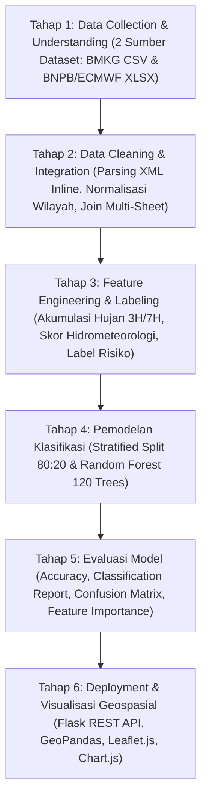
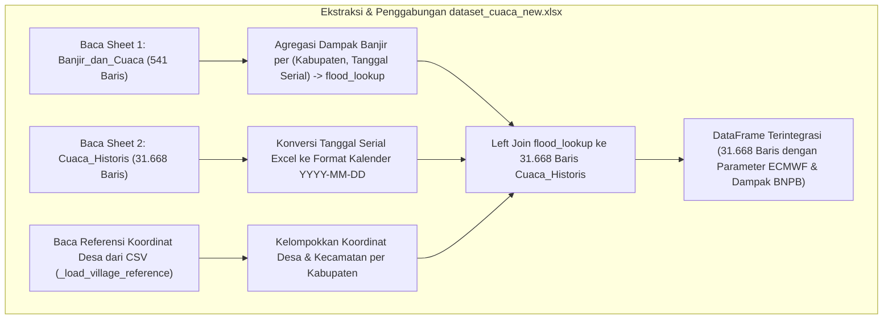
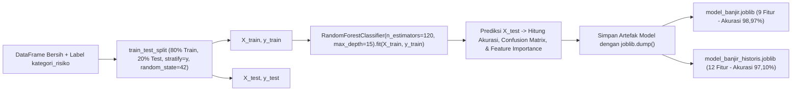

# Alur Tahapan Data Mining (KDD & CRISP-DM) Prediksi Risiko Banjir Sulawesi Tengah

Dokumen ini menguraikan alur tahapan *Data Mining* yang diterapkan pada proyek **Prediksi & Visualisasi Geospasial Risiko Banjir Provinsi Sulawesi Tengah**, mulai dari pemahaman struktur dataset mentah, ekstraksi dan penggabungan fitur (*feature engineering*), pemodelan klasifikasi dengan *Random Forest*, evaluasi performa model, hingga implementasi pada aplikasi web geospasial.

---

## 1. Diagram Alur Tahapan Data Mining

---

## 2. Spesifikasi Struktur Dataset Mentah (Data Understanding)

Sistem mengelola dua berkas dataset utama di direktori proyek:

### 2.1 Dataset 1: [dataset_cuaca_sulawesi_tengah.csv](file:///Users/user/Documents/megister/Data%20Mining/tugas_besar/dataset_cuaca_sulawesi_tengah.csv)
- **Sumber**: Badan Meteorologi, Klimatologi, dan Geofisika (BMKG) Provinsi Sulawesi Tengah.
- **Dimensi**: **39.932 baris** × **17 kolom** asli.
- **Cakupan Spasial**: **1.994 desa/kelurahan** di **13 Kabupaten/Kota** Sulawesi Tengah.
- **Atribut Utama**:
  - Identitas Wilayah: `adm4`, `provinsi`, `kabupaten_kota`, `kecamatan`, `desa_kelurahan`, `latitude`, `longitude`.
  - Waktu Pemantauan: `utc_datetime`, `local_datetime`, `jam`, `hari`, `bulan`.
  - Variabel Meteorologi: `suhu` (°C), `kelembapan` (%), `kode_cuaca`, `deskripsi_cuaca`, `kecepatan_angin` (km/h), `arah_angin`, `tutupan_awan` (%).

### 2.2 Dataset 2: [dataset_cuaca_new.xlsx](file:///Users/user/Documents/megister/Data%20Mining/tugas_besar/dataset_cuaca_new.xlsx)
Berkas Excel multi-sheet yang menggabungkan data bencana banjir aktual dari BNPB/BPBD dengan data cuaca historis harian dari *Open-Meteo Historical Weather API (ECMWF IFS)*:

| Nama Sheet | Jumlah Baris | Jumlah Kolom | Deskripsi Isi & Peran dalam Sistem |
| :--- | :--- | :--- | :--- |
| **Sheet 1: `Banjir_dan_Cuaca`** | **541 baris** | **37 kolom** | Rekaman kejadian banjir aktual di Sulawesi Tengah (`2020-01-02` s.d. `2026-08-26`) beserta dampak korban/kerusakan (`Rumah Terendam`, `Rumah Rusak`, `Fasum Rusak`, `Meninggal`, `Hilang`, `Terluka`, `Penyebab`) dan parameter cuaca saat kejadian. |
| **Sheet 2: `Cuaca_Historis`** | **31.668 baris** | **18 kolom** | Deret waktu cuaca harian lengkap (`2.436 hari` × `13 Kabupaten/Kota`, periode `2019-12-26` s.d. `2026-08-26`) yang memuat `curah_hujan_mm`, `presipitasi_total_mm`, `durasi_hujan_jam`, `hujan_3hari_sebelumnya_mm`, `hujan_7hari_sebelumnya_mm`, `kecepatan_angin_maks_kmh`, dan `elevation_grid`. |
| **Sheet 3: `Koordinat_Kabupaten`** | **13 baris** | **4 kolom** | Koordinat titik pusat kabupaten (`kab_key`, `latitude`, `longitude`) dan `jumlah_desa` per kabupaten/kota. |

---

## 3. Alur Integrasi & Transformasi Data (Data Preparation)

Pada [train_model.py](file:///Users/user/Documents/megister/Data%20Mining/tugas_besar/train_model.py), tahapan persiapan data dilakukan melalui langkah-langkah berikut:

1. **Penanganan Nilai Kosong (Imputasi)**:
   - Pada Dataset 1 (CSV), baris yang tidak memiliki nilai pada atribut krusial (`suhu`, `kelembapan`, `latitude`, `longitude`) dihapus menggunakan `dropna()`, sedangkan fitur prediktor yang hilang saat pelatihan diisi dengan nilai median (`df[features].median()`).
   - Pada Dataset 2 (XLSX), atribut numerik yang kosong diisi menggunakan nilai default meteorologi terukur (`suhu_rata2_c` = `26.5`, `kelembapan_rata2_pct` = `82.0`, `curah_hujan_mm` = `0.0`, `elevation_grid` = `0.0`).
2. **Pemetaan Kode Cuaca WMO (`WMO_WEATHER_MAP`)**:
   - Mengonversi kode numerik WMO pada `dataset_cuaca_new.xlsx` (`0`, `1`, `2`, `3`, `51`, `53`, `55`, `61`, `63`, `65`) menjadi label deskriptif bahasa Indonesia (`Cerah`, `Cerah Berawan`, `Berawan`, `Berawan Tebal`, `Gerimis Ringan/Sedang/Lebat`, `Hujan Ringan/Sedang/Lebat`).

---

## 4. Alur Pelatihan & Inferensi Model Random Forest

### Urutan Pengaruh Fitur (*Feature Importance*) pada Dataset 2 (12 Fitur)
Berdasarkan hasil pelatihan model `RandomForestClassifier` pada 31.668 baris data historis:
1. **`presipitasi` (`presipitasi_total_mm`)**: Bobot pengaruh tertinggi terhadap klasifikasi risiko banjir harian.
2. **`curah_hujan` (`curah_hujan_mm`)**: Kontributor utama kedua yang mengukur intensitas hujan langsung.
3. **`hujan_3hari` (`hujan_3hari_sebelumnya_mm`)**: Mengukur kejenuhan tanah akibat akumulasi hujan 3 hari sebelum tanggal kejadian.
4. **`kelembapan` (`kelembapan_rata2_pct`)**: Mengukur tingkat kejenuhan uap air atmosfer.
5. **`durasi_hujan` (`durasi_hujan_jam`)**: Mengukur lamanya hujan berlangsung dalam 24 jam.
6. **`hujan_7hari` (`hujan_7hari_sebelumnya_mm`)**: Mengukur akumulasi hujan mingguan pada daerah aliran sungai.
7. **Fitur Pendukung Lainnya**: `tutupan_awan`, `suhu`, `kode_cuaca`, `angin_maks`, `kecepatan_angin`, dan `elevasi`.

