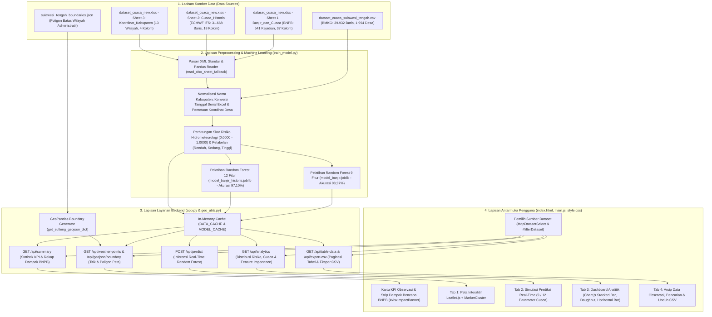

# Alur Kerja Sistem (System Flow) Prediksi & Visualisasi Geospasial Risiko Banjir Sulawesi Tengah

Dokumen ini menjelaskan alur kerja menyeluruh dari aplikasi **Sistem Prediksi & Visualisasi Peta Risiko Banjir Provinsi Sulawesi Tengah**, mulai dari pembacaan sumber data multi-format, tahapan *data preprocessing*, perhitungan skor risiko hidrometeorologi, pelatihan model *Random Forest Classifier*, layanan REST API pada Flask, hingga interaksi antarmuka pengguna berbasis peta geospasial.

---

## 1. Gambaran Umum Arsitektur & Alur End-to-End

Sistem mengintegrasikan dua sumber dataset cuaca dan kebencanaan di seluruh **13 Kabupaten/Kota Provinsi Sulawesi Tengah**:

1. **Dataset 1 (`dataset_cuaca_sulawesi_tengah.csv`)**: Data observasi dan prakiraan cuaca tingkat desa dari BMKG sebanyak **39.932 baris** yang mencakup **1.994 desa/kelurahan** dengan **9 fitur prediktor**.
2. **Dataset 2 (`dataset_cuaca_new.xlsx`)**: Buku kerja Excel multi-sheet yang menggabungkan:
   - **Sheet 2 (`Cuaca_Historis`)**: Deret waktu cuaca harian dari *Open-Meteo Historical Weather API (ECMWF IFS)* periode `2019-12-26` hingga `2026-08-26` sebanyak **31.668 baris** (18 kolom).
   - **Sheet 1 (`Banjir_dan_Cuaca`)**: Rekaman kejadian bencana banjir historis dari BNPB/BPBD sebanyak **541 kejadian** (37 kolom, mencatat total `55.529` rumah terendam, `3.170` rumah rusak, dan `208` fasilitas umum rusak).
   - **Sheet 3 (`Koordinat_Kabupaten`)**: Titik referensi geospasial dan jumlah cakupan desa untuk 13 Kabupaten/Kota (4 kolom).

---

## 2. Alur Pemrosesan Data (Data Preprocessing Flow)

Proses pembacaan dan pembersihan data ditangani oleh modul [train_model.py](file:///Users/user/Documents/megister/Data%20Mining/tugas_besar/train_model.py). Karena kedua dataset memiliki struktur kolom yang berbeda, sistem menerapkan jalur transformasi spesifik yang menghasilkan skema DataFrame terstandarisasi untuk kebutuhan API dan visualisasi.

```mermaid
flowchart LR
    START(["Permintaan Dataset (dataset_key)"]) --> RESOLVE["resolve_dataset_key(dataset_key)"]
    RESOLVE -->|dataset_cuaca_sulawesi_tengah.csv| CSV_LOAD["pd.read_csv(DATASET_CSV_PATH)"]
    RESOLVE -->|dataset_cuaca_new.xlsx| XLSX_LOAD["read_xlsx_sheet_fallback(DATASET_XLSX_PATH)"]

    subgraph Jalur_CSV["Jalur Preprocessing Dataset 1 (BMKG CSV)"]
        CSV_LOAD --> CSV_CLEAN["Konversi Kolom Numerik & Hapus Baris Kosong (suhu, kelembapan, lat, lon)"]
        CSV_CLEAN --> CSV_FEAT["Ekstraksi Fitur Waktu (jam, bulan) & Standarisasi Kolom Tambahan"]
        CSV_FEAT --> CSV_SCORE["calculate_flood_risk_score() Berbasis Cuaca, Kelembapan, Awan, Angin"]
    end

    subgraph Jalur_XLSX["Jalur Preprocessing Dataset 2 (Multi-Sheet Excel)"]
        XLSX_LOAD --> S2["Baca Sheet 2: Cuaca_Historis (31.668 Baris)"]
        XLSX_LOAD --> S1["Baca Sheet 1: Banjir_dan_Cuaca (541 Kejadian Banjir BNPB)"]
        S1 --> LOOKUP["Bangun Kamus Dampak Banjir per (Kabupaten, Tanggal Kejadian)"]
        S2 --> DATE_CONV["Konversi Tanggal Serial Excel (Origin 1899-12-30) ke YYYY-MM-DD"]
        DATE_CONV --> WMO["Pemetaan Kode Cuaca WMO ke Deskripsi Cuaca Indonesia"]
        WMO --> COORD["Distribusi Titik Koordinat Desa per Kabupaten (_load_village_reference)"]
        LOOKUP --> JOIN["Penggabungan Dampak Banjir BNPB (Rumah Terendam, Rusak, Fasum) ke Baris Harian"]
        COORD --> JOIN
        JOIN --> XLSX_SCORE["Skor Risiko Vektorisasi (Curah Hujan, Hujan 3H/7H, Durasi, Kelembapan, Dampak)"]
    end

    CSV_SCORE --> LABEL["categorize_risk(): Rendah (<0.38), Sedang (0.38-0.619), Tinggi (>=0.62)"]
    XLSX_SCORE --> LABEL
    LABEL --> OUT(["DataFrame Terstandarisasi Siap untuk Model & API"])
```

### Detail Transformasi Kunci pada [train_model.py](file:///Users/user/Documents/megister/Data%20Mining/tugas_besar/train_model.py)
1. **Pembacaan XML Inline Excel (`read_xlsx_sheet_fallback`)**: Membaca file `.xlsx` baik melalui `pandas` maupun ekstraksi langsung arsip ZIP/XML (`xl/worksheets/sheet1.xml`, `sheet2.xml`, `sheet3.xml`) yang mendukung format sel `<is><t>` (*inline string*) dan `sharedStrings.xml`.
2. **Normalisasi Nama Wilayah (`_normalize_kabupaten_name`)**: Menyeragamkan variasi penulisan nama kabupaten (seperti `BANGGAI`, `banggai_kepulauan`, `parigi_moutong`, `tolitoli`) menjadi 13 nama administratif baku Provinsi Sulawesi Tengah.
3. **Konversi Tanggal Serial Excel**: Mengubah angka serial tanggal pada `dataset_cuaca_new.xlsx` (misalnya `43825` untuk `2019-12-26`) menjadi format tanggal kalender `YYYY-MM-DD`, serta mengekstrak atribut `bulan` dan `hari`.
4. **Penggabungan Lintas Sheet (`flood_lookup`)**: Mencocokkan setiap pasangan `(kabupaten_kota, tanggal)` pada 31.668 baris `Cuaca_Historis` dengan 541 baris kejadian banjir aktual pada `Banjir_dan_Cuaca` sehingga data historis harian memuat jumlah `rumah_terendam`, `rumah_rusak`, dan `fasum_rusak`.

---

## 3. Alur Perhitungan Skor Risiko & Pelatihan Random Forest

### 3.1 Rumus Skor Risiko Hidrometeorologi (`risk_score`)

Sistem menghitung skor kontinu dalam rentang `0,0000` hingga `1,0000` sebelum mengelompokkannya ke dalam tiga kelas target:

- **Jalur Dataset 1 (BMKG CSV)**:
  $$\text{risk\_score} = \min\left(1.0,\; S_{\text{cuaca}} + S_{\text{lembap}} + S_{\text{awan}} + S_{\text{angin\_suhu}}\right)$$
  dengan bobot:
  - $S_{\text{cuaca}} \in \{0.05, 0.15, 0.20, 0.45\}$ berdasarkan deskripsi dan kode cuaca BMKG.
  - $S_{\text{lembap}} = \max(0, \frac{\text{kelembapan} - 50}{50}) \times 0.30$
  - $S_{\text{awan}} = \frac{\text{tutupan\_awan}}{100} \times 0.15$
  - $S_{\text{angin\_suhu}} = \min(0.10, \frac{\text{kecepatan\_angin}}{40} \times 0.05 + \max(0, \frac{30 - \text{suhu}}{15}) \times 0.05)$

- **Jalur Dataset 2 (ECMWF Historis & Banjir BNPB)**:
  $$\text{risk\_score} = \min\left(1.0,\; S_{\text{hujan}} + S_{\text{ant}} + S_{\text{durasi}} + S_{\text{lembap}} + S_{\text{awan}} + S_{\text{dampak}}\right)$$
  dengan bobot:
  - $S_{\text{hujan}} = \min(0.32, \frac{\max(\text{curah\_hujan}, \text{presipitasi})}{28.0} \times 0.32)$
  - $S_{\text{ant}} = \min(0.22, \frac{\text{hujan\_3hari}}{55.0} \times 0.14 + \frac{\text{hujan\_7hari}}{110.0} \times 0.08)$
  - $S_{\text{durasi}} = \min(0.14, \frac{\text{durasi\_hujan}}{18.0} \times 0.14)$
  - $S_{\text{lembap}} = \max(0, \frac{\text{kelembapan} - 60.0}{40.0}) \times 0.15$
  - $S_{\text{awan}} = \frac{\text{tutupan\_awan}}{100.0} \times 0.05$
  - $S_{\text{dampak}} = \min(0.12, \frac{\text{rumah\_terendam} + 2\cdot\text{rumah\_rusak} + 5\cdot\text{fasum\_rusak}}{180.0} \times 0.12)$

- **Ambang Kategori Risiko (`categorize_risk`)**:
  - **Tinggi (Siaga)**: $\text{risk\_score} \ge 0.62$
  - **Sedang (Waspada)**: $0.38 \le \text{risk\_score} < 0.62$
  - **Rendah (Aman)**: $\text{risk\_score} < 0.38$

### 3.2 Perbandingan Fitur Model Random Forest

| Komponen Model | Dataset 1 (`dataset_cuaca_sulawesi_tengah.csv`) | Dataset 2 (`dataset_cuaca_new.xlsx`) |
| :--- | :--- | :--- |
| **File Artefak Model** | `model_banjir.joblib` | `model_banjir_historis.joblib` |
| **Jumlah Baris Total** | 39.932 baris | 31.668 baris |
| **Sampel Latih / Uji (80:20)** | 31.945 latih / 7.987 uji | 25.334 latih / 6.334 uji |
| **Jumlah Fitur Prediktor** | **9 Fitur** (`suhu`, `kelembapan`, `kode_cuaca`, `kecepatan_angin`, `tutupan_awan`, `latitude`, `longitude`, `jam`, `bulan`) | **12 Fitur** (`curah_hujan`, `presipitasi`, `durasi_hujan`, `hujan_3hari`, `hujan_7hari`, `suhu`, `kelembapan`, `tutupan_awan`, `kecepatan_angin`, `angin_maks`, `elevasi`, `kode_cuaca`) |
| **Konfigurasi Estimator** | `n_estimators=120, max_depth=15, random_state=42` | `n_estimators=120, max_depth=15, random_state=42` |
| **Akurasi Data Uji** | **98,97%** | **97,10%** |

---

## 4. Alur Komunikasi Frontend dan Backend (Sequence Diagram)

Diagram urutan berikut menggambarkan interaksi antara browser pengguna ([main.js](file:///Users/user/Documents/megister/Data%20Mining/tugas_besar/static/js/main.js)) dan server Flask ([app.py](file:///Users/user/Documents/megister/Data%20Mining/tugas_besar/app.py)) saat halaman dimuat pertama kali, saat pengguna mengganti dataset, dan saat menjalankan simulasi prediksi banjir.

```mermaid
sequenceDiagram
    actor User as Pengguna
    participant UI as Browser UI (index.html & main.js)
    participant API as Flask Server (app.py)
    participant Cache as DATA_CACHE & MODEL_CACHE
    participant Geo as GeoPandas (geo_utils.py)

    Note over User,Geo: A. Inisialisasi Awal Halaman (DOMContentLoaded)
    User->>UI: Buka http://localhost:5050
    UI->>API: GET /
    API-->>UI: Render templates/index.html
    par Muat Ringkasan, Peta, Analitik, dan Tabel Paralel
        UI->>API: GET /api/summary?dataset=dataset_cuaca_sulawesi_tengah.csv
        API->>Cache: get_data_and_model(dataset)
        Cache-->>API: DataFrame + Model Artifact
        API-->>UI: JSON KPI (total, tinggi, sedang, rendah, kabupaten_list)
    and
        UI->>API: GET /api/geojson/boundary?dataset=...
        API->>Geo: get_sulteng_geojson_dict(df)
        Geo-->>API: GeoJSON Polygon 13 Kabupaten/Kota
        API-->>UI: GeoJSON FeatureCollection
        UI->>API: GET /api/weather-points?dataset=...&limit=2000
        API-->>UI: JSON 2.000 Titik Observasi Spasial
    and
        UI->>API: GET /api/analytics?dataset=...
        API-->>UI: JSON Risiko per Kabupaten, Distribusi Cuaca & Feature Importance
    and
        UI->>API: GET /api/table-data?dataset=...&page=1&limit=12
        API-->>UI: JSON 12 Baris Tabel & Metadata Paginasi
    end

    Note over User,Geo: B. Pergantian Sumber Dataset (handleDatasetSwitch)
    User->>UI: Pilih "Dataset 2 (dataset_cuaca_new.xlsx)" pada <select>
    UI->>UI: syncDatasetSelectors("dataset_cuaca_new.xlsx")
    UI->>API: GET /api/summary?dataset=dataset_cuaca_new.xlsx
    API->>Cache: Ambil Data 31.668 Baris & Model 12 Fitur
    API-->>UI: JSON KPI + Dampak BNPB (55.529 Rumah Terendam, 3.170 Rusak)
    UI->>UI: Tampilkan #xlsxImpactBanner & #xlsxSimFields (5 Slider Baru)
    UI->>API: GET /api/weather-points, /api/analytics, /api/table-data
    API-->>UI: Data Titik Peta, Grafik 12 Fitur, & Tabel 9 Kolom Historis

    Note over User,Geo: C. Simulasi Prediksi Real-Time (POST /api/predict)
    User->>UI: Atur Slider Cuaca / Klik Preset & Tekan "Prediksi Sekarang"
    UI->>API: POST /api/predict (Payload JSON Parameter Cuaca)
    API->>Cache: Ambil RandomForestClassifier Sesuai Dataset Aktif
    API->>API: clf.predict(X_pred) & clf.predict_proba(X_pred)
    API-->>UI: JSON {prediction: "Tinggi", probabilities: {Tinggi, Sedang, Rendah}}
    UI->>UI: Render Kartu Status Risiko & Bar Probabilitas
```

---

## 5. Alur Navigasi & State Antarmuka Pengguna

Antarmuka pengguna pada [templates/index.html](file:///Users/user/Documents/megister/Data%20Mining/tugas_besar/templates/index.html) memiliki empat tab fungsional yang saling terhubung dengan filter geospasial dan kartu KPI di bagian atas halaman:

```mermaid
stateDiagram-v2
    [*] --> Ringkasan_KPI: Halaman Dimuat

    state Ringkasan_KPI {
        Pilih_Dataset: Dropdown #topDatasetSelect / #filterDataset
        Kartu_KPI: Klik Kartu Total / Tinggi / Sedang / Rendah
        Banner_BNPB: Strip #xlsxImpactBanner (Aktif pada Dataset 2)
        Filter_Spasial: Pilih Kabupaten/Kota & Tingkat Risiko
    }

    Ringkasan_KPI --> Tab_Peta: Default / Klik Tab 1
    Ringkasan_KPI --> Tab_Simulasi: Klik Tab 2
    Ringkasan_KPI --> Tab_Analitik: Klik Tab 3
    Ringkasan_KPI --> Tab_Arsip_Data: Klik Tab 4

    state Tab_Peta {
        Leaflet_GeoJSON: Layer Batas Administratif 13 Kabupaten/Kota
        Marker_Cluster: Gugus Titik Cuaca Berwarna (Hijau, Kuning, Merah)
        Popup_Detail: Klik Titik untuk Detail Cuaca, Elevasi, & Dampak Banjir
    }

    state Tab_Simulasi {
        Input_Standar: 7 Slider Dasar + Pilih Wilayah & Kondisi Cuaca
        Input_Historis: 5 Slider Tambahan (Presipitasi, Hujan 3H/7H, Angin Maks, Elevasi)
        Preset_Cepat: Tombol Hujan Ekstrem, Hujan Sedang, Cuaca Cerah
        Output_RF: Status Risiko (Tinggi/Sedang/Rendah) & Persentase Probabilitas
    }

    state Tab_Analitik {
        Grafik_Kabupaten: Stacked Bar Sebaran Risiko per Kabupaten
        Grafik_Cuaca: Doughnut Proporsi Deskripsi Cuaca
        Grafik_Fitur: Horizontal Bar Feature Importance (9 atau 12 Fitur)
    }

    state Tab_Arsip_Data {
        Pencarian_Cepat: Input #tableSearch (Kabupaten, Kecamatan, Desa, Penyebab)
        Tabel_Dinamis: Header & Sel Menyesuaikan Skema Dataset (CSV vs XLSX)
        Paginasi_Ekspor: Navigasi Halaman & Tombol Unduh CSV (/api/export-csv)
    }
```

---

## 6. Daftar Endpoint REST API ([app.py](file:///Users/user/Documents/megister/Data%20Mining/tugas_besar/app.py))

| Endpoint | Metode | Parameter Query / Body | Fungsi & Keluaran Utama |
| :--- | :--- | :--- | :--- |
| `/` | `GET` | - | Merender halaman utama [templates/index.html](file:///Users/user/Documents/megister/Data%20Mining/tugas_besar/templates/index.html) beserta kunci peta opsional `MAP_API_KEY`. |
| `/api/datasets` | `GET` | - | Mengembalikan daftar metadata sumber dataset yang tersedia di `DATASETS_META`. |
| `/api/summary` | `GET` | `dataset`, `kabupaten`, `risk` | Mengembalikan jumlah observasi, distribusi risiko (`Tinggi`, `Sedang`, `Rendah`), rekap dampak BNPB (`total_rumah_terendam`, `total_rumah_rusak`, `total_fasum_rusak`), rata-rata hujan harian dan 3 harian, serta daftar kabupaten dan median elevasinya. |
| `/api/geojson/boundary` | `GET` | `dataset` | Mengembalikan poligon batas wilayah Sulawesi Tengah dalam format GeoJSON dari [geo_utils.py](file:///Users/user/Documents/megister/Data%20Mining/tugas_besar/geo_utils.py). |
| `/api/weather-points` | `GET` | `dataset`, `kabupaten`, `risk`, `limit` | Mengembalikan daftar titik koordinat unik teratas berdasarkan `risk_score` lengkap dengan parameter meteorologi dan dampak bencana untuk digambar pada peta Leaflet. |
| `/api/predict` | `POST` | JSON: `dataset`, `kabupaten`, `suhu`, `kelembapan`, `tutupan_awan`, `kecepatan_angin`, `angin_maks`, `kode_cuaca`, `jam`, `bulan`, `curah_hujan`, `presipitasi`, `durasi_hujan`, `hujan_3hari`, `hujan_7hari`, `elevasi` | Menjalankan prediksi *real-time* menggunakan model *Random Forest* yang sesuai dengan dataset aktif dan mengembalikan kelas risiko beserta probabilitasnya. |
| `/api/analytics` | `GET` | `dataset` | Mengembalikan data agregasi risiko per kabupaten/kota, distribusi kondisi cuaca, akurasi model, dan bobot `feature_importances` untuk grafik Chart.js. |
| `/api/table-data` | `GET` | `dataset`, `page`, `limit`, `kabupaten`, `risk`, `search` | Mengembalikan baris data terfilter dengan paginasi server-side untuk ditampilkan pada tabel Arsip Data Observasi. |
| `/api/export-csv` | `GET` | `dataset` | Mengunduh seluruh baris DataFrame hasil olahan dan prediksi dari dataset aktif sebagai berkas `.csv`. |

